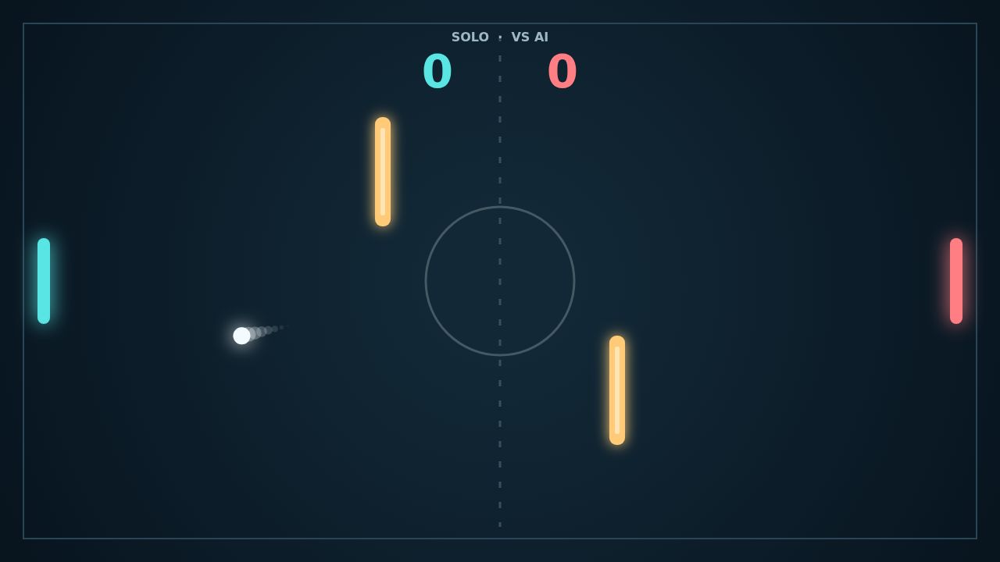

# Carom

Two paddles face each other across a dark court. The first serve comes from the center, and each point ends only when the ball clears the far edge behind a paddle. Reach eleven with a two-point lead to take the match.

A centered return drives straight across, while a catch near the end of a paddle sends the ball at an angle. Move the paddle as the ball arrives and the shot takes on spin, bending after impact. A late curve can pull a rally back into reach or slip it away from the other side.

The two gold bars make the center of the field a puzzle. Shots glance off them without losing speed, opening up bank shots that change the rhythm of a rally. In Solo, the AI tracks incoming balls and recovers toward center; in Versus, both players share the keyboard and every angle is earned by hand.

